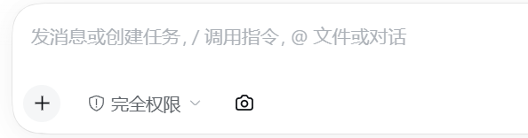

# dsh-shot

Screenshot button for the DeepSeek Harness composer. Click the camera, the whole screen freezes and dims, hover a window or drag a frame, scribble a note if you want, hit confirm — the crop lands in your draft as a prompt image. The move Doubao and QQ already give you, inside DSH.

给 DeepSeek Harness 输入框加一个截图按钮：点一下 → 整屏冻结压暗 → 悬停整窗或拖拽框选 → 确认，框到的画面直接成为当前会话的图片附件。




框选层不是 DSH 页面里的 DOM，而是宿主另开的**分层窗口**：每个显示器一个无边框置顶窗口，整屏（含任务栏）一起冻结压暗，DSH 主窗口不会被推着缩放再弹回来。版式照着豆包/微信的截图工具走——冻结画面、白色虚线选区配 8 个圆形手柄、选区左上的尺寸浮标（`宽 * 高`）、选区下方一条操作条。

## 功能

- **悬停即选中整窗**：鼠标停在任意窗口上立刻框出它，移开自动取消；单击锁定成选区。铺满屏幕的壳窗口（桌面、悬浮层）会自动跳过。
- **选区可反复调整**：拖整框移动，拖八个手柄缩放，一次选不准不用重来。
- **标注**：矩形 / 椭圆 / 箭头（实心带翼）/ 画笔，加撤销、重做。
- **十字光标**：进入截图就是系统十字（`IDC_CROSS`），手柄上变方向箭头、框内变四向移动、工具条按钮变手型。
- **逐像素交付**：预览按设备像素绘制，裁剪出的 PNG 不做任何缩放，和高分屏截图工具一致。
- **Esc / 鼠标右键同义**：编辑态先退回自由框选，再按一次才退出。
- 仅 Windows（截屏走 GDI）。

## 安装

插件分两半：host 半（`index.js`，真的抓屏）与 client 半（`client.js`，按钮与兜底遮罩）。

1. 取回代码放进任意目录，例如 `D:\plugins\dsh-shot`。
2. 在 DSH profile 的 `package.json`（`C:\Users\<you>\.dsh\profiles\<profile>\package.json`）里加依赖与 bundle：
   ```jsonc
   "dependencies": { "dsh-shot": "link:D:/plugins/dsh-shot" },
   "dsh": { "profile": { "bundles": [ /* … */ "dsh-shot" ] } }
   ```
3. 让 `node_modules` 能解析到它。没有 pnpm 时用目录联接（管理员权限的 cmd 里 `mklink /J` 也一样）：
   ```powershell
   New-Item -ItemType Junction `
     -Path   "$env:USERPROFILE\.dsh\profiles\<profile>\node_modules\dsh-shot" `
     -Target "D:\plugins\dsh-shot"
   ```
4. `plugin_manager` 里打开：`set_bundle(target="dsh-shot", enabled=true)`。它会把插件 import 进运行中的 composition，host 半立即生效。
5. **client 半要重启桌面端**（生产构建没有重载渲染进程的入口）。重启后输入框左侧出现相机图标。

改过 `client.js` 之后连做三步：`set_bundle(false)` → `set_bundle(true)` → 重启 DSH。只重跑 `enabled=true` 会返回 `changed:false`，因为组合体字节在 graph 重建时已进内存缓存，而渲染进程的 URL rev 由文件 `mtime` 推导，不重启拿不到新字节。

## 用法

分层窗口引擎（默认）下的操作：

| 操作 | 效果 |
| --- | --- |
| 点相机按钮 | 抓屏、整屏压暗并进入框选 |
| 鼠标停在窗口上 | **立刻自动框出整个窗口**，不用先点；移开就取消 |
| 拖动鼠标 | 自由框选，松手即锁定并可继续调整 |
| 单击 | 锁定当前框（悬停框出的，或刚拖出的） |
| 拖动框内 / 拖八个手柄 | 整体移动 / 改大小 |
| 工具条 | `移动 · 矩形 · 椭圆 · 箭头 · 画笔 | 撤销 · 取消 · 确认` |
| `Enter` | 确认 |
| `Esc` / 鼠标右键 | 先退回自由框选，再按一次退出 |
| 右键相机按钮 | 切换「截屏时隐藏本窗口」（默认开，存 `localStorage`） |
| 工具条「复制」 | 结果写进剪贴板（渲染进程剪贴板权限被拒时改为下载文件） |

页内兜底遮罩还支持 `R` `O` `A` `P` 键切工具、`Ctrl+Z` / `Ctrl+Shift+Z` 撤销重做、双击选区内确认。

## 两种框选引擎

| 引擎 | 何时使用 | 遮罩在哪 | 标注 |
| --- | --- | --- | --- |
| 分层窗口（默认） | Windows 桌面端，`overlay.ps1` 可用 | 宿主进程的 WPF 置顶窗口，每屏一个 | 矩形 / 椭圆 / 箭头 / 画笔 + 撤销 / 取消 / 确认、悬停整窗、移动与八向缩放 |
| 页面内遮罩（兜底） | 宿主取不到覆盖层，或路由报错 | DSH 渲染进程里的 DOM 遮罩 | 矩形 / 椭圆 / 箭头 / 画笔 + 撤销重做、快捷键 |

默认走分层窗口：点按钮后宿主把冻结的全屏 PNG 抓到临时目录（按开关决定是否先最小化自己），`overlay.ps1` 把冻结图铺到每块屏幕上（**彩色冻结图 + 半透明黑色压暗**，暗区仍保留原色，不做灰度化）——这一步不中途还原窗口，所以不会「窗口冒两次」。确认后才用 GDI 从冻结图裁出物理像素 PNG 交给页面，覆盖层进程退出后宿主再把 DSH 窗口还原回原几何。兜底遮罩仍在：宿主返回 204 / 非图片 / 抛错时自动回退，功能不会整个消失。

## 为什么需要 host 半

桌面端主进程在 `configureSession` 里把渲染进程的 `display-capture`、`clipboard-read` 等权限一律拒掉（`setPermissionRequestHandler` 回 false、`setDisplayMediaRequestHandler` 回空对象），页面里拿不到 `getDisplayMedia`，纯前端截屏这条路封死。

所以截屏交给操作系统：host 半用 PowerShell + GDI `CopyFromScreen` 抓整个虚拟桌面，PNG 编码到临时文件后读字节流回传（每次用唯一文件名，用完即删），响应带 `x-dsh-screen-width/height/origin-x/origin-y`，前端据此把选区换算回物理像素并从原图取原生像素。

「隐藏本窗口」打开时，host 只做「最小化 → 抓屏」，**不会**中途还原或最大化；等覆盖层退出后才 `ShowWindow` 回来并按存下的矩形摆位（原本最大化就回最大化）。还原脚本必须 `SetProcessDpiAwarenessContext(-4)`，否则 150% 缩放下 `SetWindowPos` 会被再放大 1.5 倍；摆位后用 `GetWindowRect` 复核，最后无条件 `SetWindowPos(HWND_NOTOPMOST, 0x0013)` 清掉置顶位。

## 截图怎么进输入框

不替换 slot、也不调上传接口，复用官方已有的两条入口：

1. 合成 `ClipboardEvent('paste')`（`clipboardData` 是塞了 `File` 的 `DataTransfer`）——`createComposerFileIntake` 在 document 上监听 paste，取文件后交给当前 composer；
2. 失败再合成 `dragenter/dragover/drop`——`installDocumentDropEvents` 只要 `dataTransfer.types` 含 `Files` 就收。

两条路都不检查 `isTrusted`。注入后看草稿栏里 `img[src^="blob:"]` 是否出现来确认真的进去了；没进去会弹提示，不静默失败。

输入框忙的时候（正在生成回复、会话被锁、附件上传被禁用），`intakeFiles` 会直接 `return`，连 toast 都没有。所以注入前先看 paste 事件是否被 `preventDefault`（只有挑到目标 composer 才会），被拒就每 700 ms 重试、最多等 5 分钟，并提示「等这条回复结束会自动把截图贴进去」。

## 清晰度：预览按设备像素画

若把 2560×1600 的截图按 CSS 像素铺在 1700×1067 的画布后备区上，浏览器还会按 `devicePixelRatio`（这台 150% 缩放是 1.5）合成放大——先缩一次再放一次，两次重采样，预览发糊。

现在 `scale = min(视口宽/图宽, 视口高/图高, 1/devicePixelRatio)`，画布后备区取 `shownWidth × dpr`、CSS 尺寸仍取 `shownWidth`。于是「截屏尺寸 = 屏幕尺寸」时画布 1 像素正好对 1 个物理像素，零重采样；裁剪用 `imageSmoothingEnabled = false` 从原图取原生像素。

## 已知边界

- 只支持 Windows；其它平台路由返回 500 并说明不支持。
- 单次抓屏约 1–4 s（冷启动要编译 C# 声明），抓图期间按钮是 busy 态。
- 多显示器时抓整个虚拟桌面，框选坐标按 `origin-x/origin-y` 对齐；选区暂不能跨屏拆分。
- 「+」菜单是 shipped UI，没有可注入的条目 slot，所以入口是输入框左侧的独立按钮，不占用全局快捷键。
- 标注画上之后不可再编辑，只能撤销重画。

## 更新与卸载

- 更新：`git pull`（或重新下载）后按需重启桌面端；只改了 `overlay.ps1` / `index.js` 不必重启——host 每次点击都现起 PowerShell。
- 卸载：profile `package.json` 里删掉 `dependencies` 与 `dsh.profile.bundles` 两项，删掉 `node_modules\dsh-shot` 联接，重启桌面端。

## 版本

- **0.2.3** —— 覆盖层整屏化（宿主分层窗口）、悬停即选整窗、选区可移动/八手柄缩放、工具条去掉马赛克与文字、系统十字光标、修复悬停框偏移与工具条中文乱码。
- **0.2.1** —— 单 Path 挖洞遮罩（消除选区两侧的接缝细线）、箭头改实心带翼、窗口吸附。
- **0.2.0** —— 原生 WPF 覆盖层（`overlay.ps1`），从页面 DOM 遮罩迁出。
- **0.1.0** —— 首个版本：host 抓屏 + 页内 DOM 框选 + 合成 paste 注入 composer。

## 开发笔记（踩过的坑）

- 插件挂 `dsh.client` 时，`client.js` 必须是 `window.__ModuleLoader__.load({ id, factory })` 形态，工厂返回 `{ inject, apply }`，且 `id` 必须等于包名。
- client 半是纯 DOM 与 React 混用：`apply()` 里抛错，slot 注册会整体回滚、按钮无声消失。先看宿主日志，不要猜。
- slot 占用者是 React 组件，往里塞 `document.createElement` 造的节点会抛 `Objects are not valid as a React child`——用 `dangerouslySetInnerHTML` 包一层。
- `overlay.ps1` 必须存成 **UTF-8 with BOM**：无 BOM 时 Windows PowerShell 5.1 按 ANSI 解码，中文提示与引号全坏（工具条变乱码就是这么来的）。
- 给 PowerShell 喂多行脚本**不要用** `-Command -` + stdin：带 here-string 的脚本会静默不执行、退出码 0、stdout 全空。用 `-EncodedCommand`（UTF-16LE base64）。
- 任何调 `SetWindowPos` 的脚本都要先 `SetProcessDpiAwarenessContext(-4)`，否则 150% 缩放下坐标被再放大一次（「窗口变大了」的经典原因）。
- 用四块半透明矩形拼遮罩必然出接缝线：留缝是亮线、重叠是暗线。改成一个 `Path` + `CombinedGeometry(Exclude)` 挖洞。
- 分层窗口的鼠标事件不会自动落到按钮上：遮罩若在 `pointerdown` 里无条件捕获，工具条点击会被读成「重新框选」。命中工具条时要提前 return。
- `$w.factor`（DIP→物理）必须在每次 `MouseMove` 与应用遮罩前同步，只在按下时算的话，首屏悬停出来的框会偏 1.5 倍。
- GDI 的 `Bitmap.Save` 覆盖同名文件会抛 `GDI+ 中发生一般性错误`（文件被占用），所以要唯一文件名。

## 许可

MIT